# Attention, Explained

**A step-by-step, figure-rich course that builds the attention mechanism and the Transformer from scratch, explained through NLP. 12 notebooks, every figure computed live, all runnable in your browser on Google Colab.**

[](https://github.com/hentablihamza/attention-explained/actions/workflows/ci.yml)
[](https://www.python.org)
[](https://colab.research.google.com/github/hentablihamza/attention-explained/blob/main/notebooks/01_why_attention.ipynb)

## Why this course

Attention is the one idea behind BERT, GPT, AlphaFold and today's chemical and protein language models, yet most explanations either stop at a diagram or jump straight to a 100-line library call. This course goes **one step at a time**, from *"why do we need it?"* to a Transformer you train yourself, and it **shows you the numbers**:

- every formula is worked on tiny examples you can follow by hand;
- every claim is checked by an **experiment you run** (with vs without attention, 1 vs 3 heads, with vs without residuals, masked vs unmasked);
- every figure in this README was **generated by the notebooks**, so none of it is a stock illustration.

No GPU, no downloads, no API keys: toy sentences and small CPU models that train in seconds.

## The story in figures

**1. The problem.** A plain encoder–decoder must squeeze the whole input into one vector. On a sequence-reversal task, its accuracy collapses as inputs grow; the same model **with attention** holds up far better (Notebook 01).

| Bottleneck, measured | What the attention model learned |
|---|---|
| 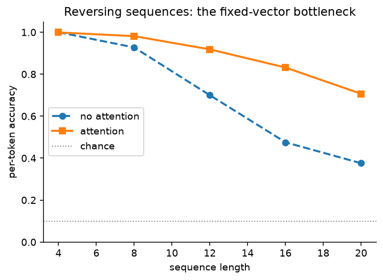 | 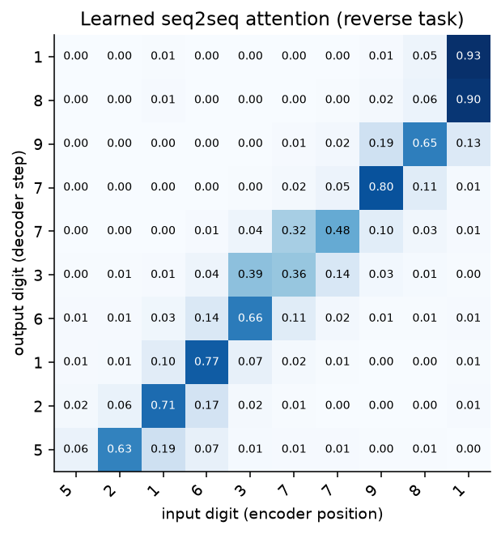 |

**2. Words become vectors** whose geometry carries meaning, learned here from 45 toy sentences (Notebook 02).

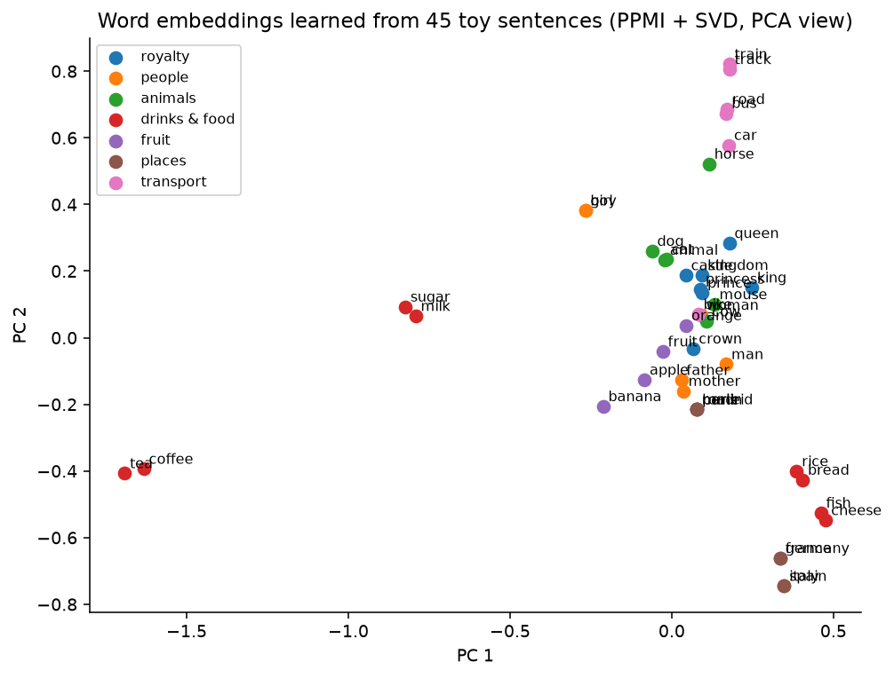

**3. Query, Key, Value.** Attention is a soft dictionary lookup. Every panel below is a real matrix computed in Notebook 03.

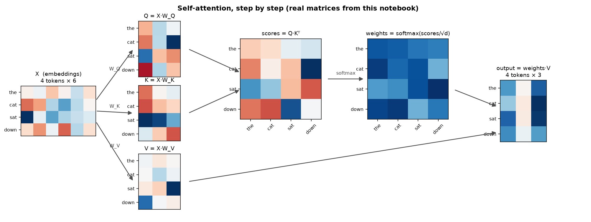

**4. The formula, by hand**, $\mathrm{softmax}(QK^\top/\sqrt{d_k})\,V$, with every intermediate number printed (Notebook 04), then drawn as the classic **attention heatmap** (Notebook 05).

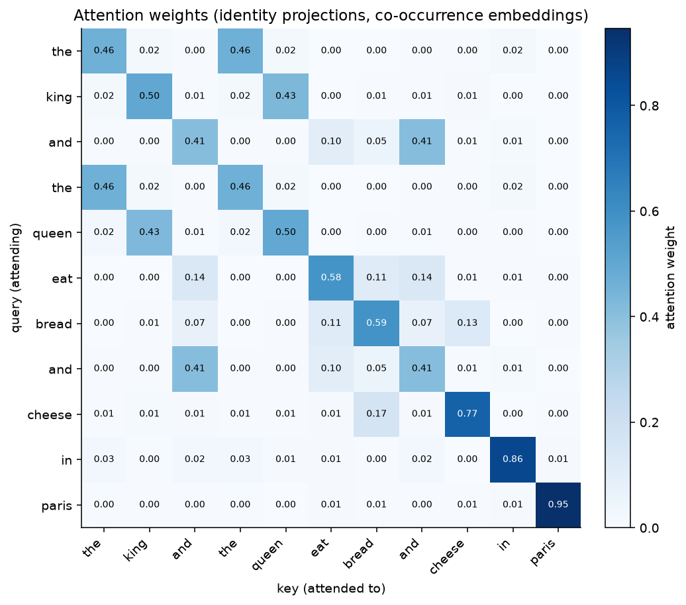

**5. Self-attention resolves "it".** A tiny model trained in Notebook 06 points *it* to **animal** when the animal is *tired* and to **street** when the street is *wide*, on (animal, place) pairs it never saw in training. An ablation then shows which attention connections actually carry the clue.

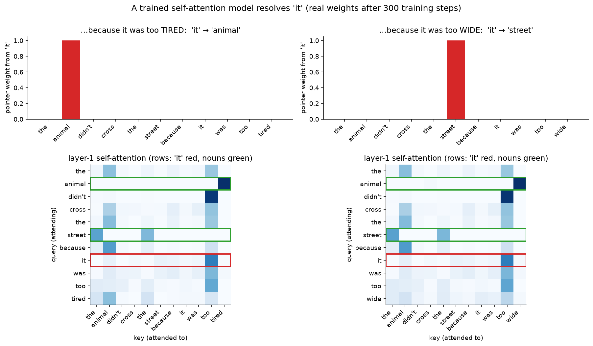

**6. Multi-head attention.** Three heads of one trained layer split the work: previous token, next token, first token (Notebook 07).

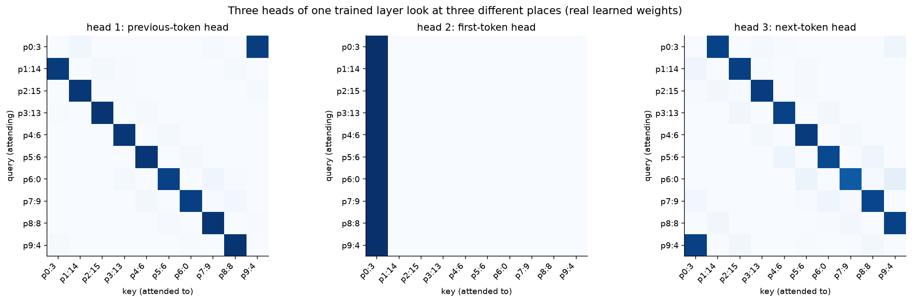

**7. Position** has to be injected, because attention is order-blind (Notebook 08). **8. The block** wraps attention with an FFN, residuals and LayerNorm (Notebook 09).

| Sinusoidal positional encoding | The Transformer block |
|---|---|
| 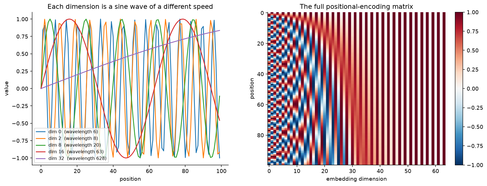 | 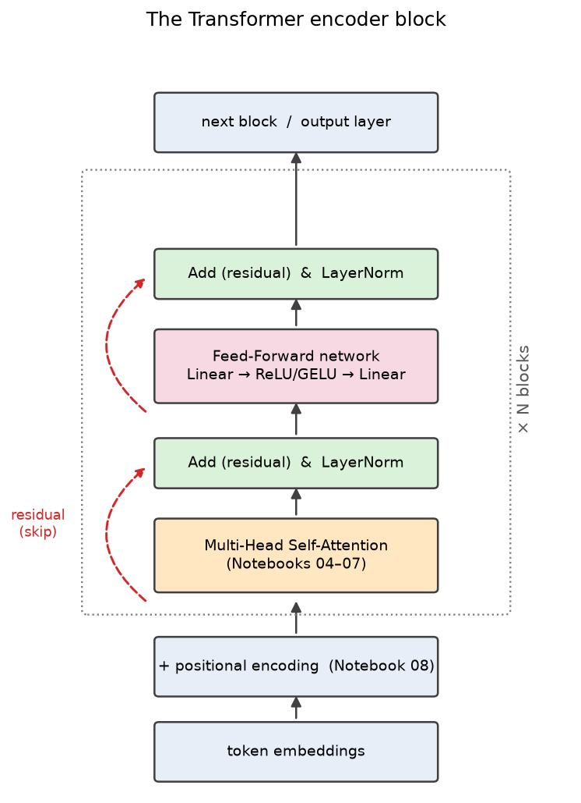 |

**9. Causal masking** for generation, plus a training experiment showing an unmasked model that cheats (Notebook 10).

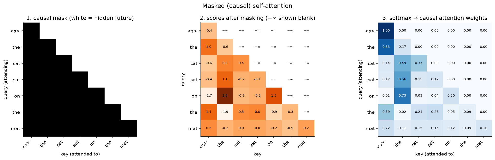

**10. A tiny Transformer trained live.** Built from scratch, trained on a CPU to sort digits. Below are the real loss and accuracy curves, and the attention it learned, where late heads retrieve tokens **by rank** (Notebook 11).

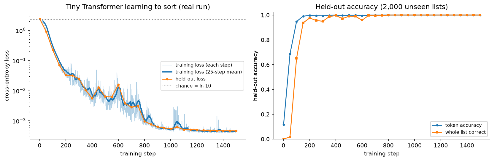

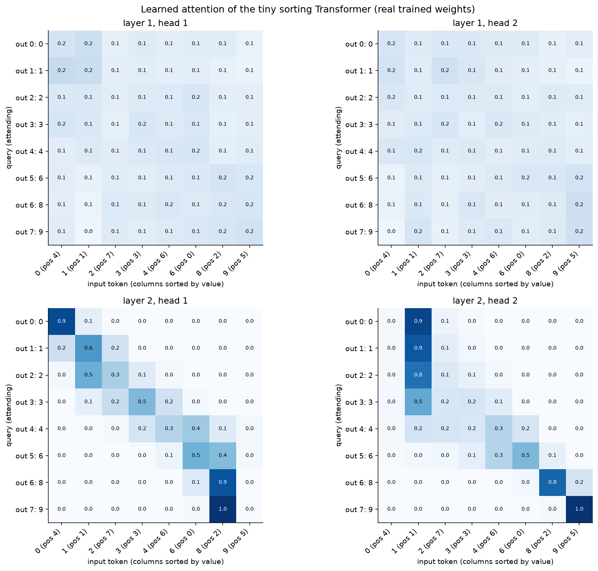

**11. From here to GPT and BERT.** BERT, GPT and T5 use the same block with different masks and training objectives (Notebook 12).

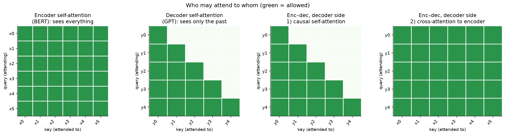

## Who this is for

- **Ph.D. / master's students and researchers** in any field (chemistry, biology, physics, medicine…) who use Transformers and want to really understand them.
- **Data scientists and developers** moving from "calling a model" to "knowing what is inside".
- **Teachers** who need runnable, verifiable material for a lecture on attention.

You need basic Python and NumPy. The linear algebra is just matrix multiplication and is explained as it appears.

## Syllabus

Click a badge to open a notebook in Colab, or browse [`notebooks/`](notebooks).

| # | Notebook | You will… | Colab |
|---|----------|-----------|-------|
| 01 | Why attention? | the seq2seq bottleneck, measured: GRU with vs without attention on longer and longer inputs | [](https://colab.research.google.com/github/hentablihamza/attention-explained/blob/main/notebooks/01_why_attention.ipynb) |
| 02 | Words to vectors | tokenization (incl. a tiny BPE), embeddings learned from co-occurrence, cosine similarity, PCA | [](https://colab.research.google.com/github/hentablihamza/attention-explained/blob/main/notebooks/02_words_to_vectors.ipynb) |
| 03 | Query, Key, Value | attention as a soft dictionary lookup; where $W_Q, W_K, W_V$ come from | [](https://colab.research.google.com/github/hentablihamza/attention-explained/blob/main/notebooks/03_query_key_value.ipynb) |
| 04 | Scaled dot-product attention, by hand | softmax(QKᵀ/√d)V with every number printed; why √d, measured | [](https://colab.research.google.com/github/hentablihamza/attention-explained/blob/main/notebooks/04_scaled_dot_product_attention.ipynb) |
| 05 | Attention as a heatmap | read attention matrices; temperature and entropy; limits of attention as explanation | [](https://colab.research.google.com/github/hentablihamza/attention-explained/blob/main/notebooks/05_attention_heatmaps.ipynb) |
| 06 | Self-attention | train a tiny model on *"…because **it** was too tired"*; read and **ablate** its attention | [](https://colab.research.google.com/github/hentablihamza/attention-explained/blob/main/notebooks/06_self_attention.ipynb) |
| 07 | Multi-head attention | implement heads by reshaping; watch 3 heads learn 3 different jobs | [](https://colab.research.google.com/github/hentablihamza/attention-explained/blob/main/notebooks/07_multi_head_attention.ipynb) |
| 08 | Positional encoding | prove attention is order-blind; sinusoidal encodings; shift = rotation; RoPE | [](https://colab.research.google.com/github/hentablihamza/attention-explained/blob/main/notebooks/08_positional_encoding.ipynb) |
| 09 | The Transformer block | LayerNorm, FFN, residuals; parameter counts; rank collapse without residuals | [](https://colab.research.google.com/github/hentablihamza/attention-explained/blob/main/notebooks/09_transformer_block.ipynb) |
| 10 | Masked (causal) attention | the triangular mask; no-leak proof; an unmasked model that cheats; KV cache | [](https://colab.research.google.com/github/hentablihamza/attention-explained/blob/main/notebooks/10_masked_attention.ipynb) |
| 11 | A tiny Transformer, trained live | build from scratch, train to sort digits on CPU, NumPy re-implementation, learned attention | [](https://colab.research.google.com/github/hentablihamza/attention-explained/blob/main/notebooks/11_tiny_transformer.ipynb) |
| 12 | From here to GPT and BERT | encoder vs decoder; train a tiny GPT and a tiny BERT; GPT-2 parameter count; O(n²); cheat-sheet | [](https://colab.research.google.com/github/hentablihamza/attention-explained/blob/main/notebooks/12_from_here_to_gpt_and_bert.ipynb) |

Each notebook has clear **learning objectives**, step-by-step Markdown explanations, runnable code, figures generated from real computation, and **exercises with collapsible solutions**. Work them in order; each one builds on the last.

## Selected results (from the executed notebooks)

All numbers below are printed by cells in the notebooks (CPU, fixed seeds). They may vary slightly across machines and PyTorch versions; the comparisons are the point.

| Notebook | Experiment | Result |
|----------|------------|--------|
| 01 | Reverse digit sequences with a GRU seq2seq, no attention vs attention (per-token accuracy) | length 8: **0.93 → 0.98** · length 16: **0.48 → 0.83** · length 20: **0.38 → 0.71** |
| 04 | Why divide by √d: average largest softmax weight over 10 random keys | d = 1024: **0.97 without scaling** (saturated) vs **0.32 with /√d** |
| 06 | Tiny self-attention model resolving *it* (*tired* → animal, *wide* → street) | **100%** on 1,000 sentences from 12 **held-out** (animal, place) pairs; blocking nouns → adjective drops it to **49%** (chance) |
| 07 | One layer, 3 lookups at once (previous / next / first token), same width | 1 head: next-token accuracy **0.26**; 3 heads: **1.00 / 1.00 / 1.00** |
| 09 | 12 blocks learning to reverse a list, with vs without residual connections | final loss **0.001** vs **2.77** (stuck at chance, ln 16) |
| 10 | Next-token model trained with vs without the causal mask | both reach training loss ≈ 0.0003, but generation accuracy **1.00** vs **0.17** (the unmasked model cheats) |
| 11 | Tiny Transformer (2 blocks, 2 heads, 101,898 parameters) learning to sort 8 digits, 1,500 steps on CPU | held-out loss **0.0005**, token accuracy **1.000**, whole-list accuracy **1.000** on 2,000 unseen lists; NumPy re-implementation agrees on **500/500** |
| 12 | GPT-2 parameter count from its shape | **124.4 M / 354.8 M / 774.0 M / 1,557.6 M** for small / medium / large / XL |

## How to use it

### Option 1: Google Colab (nothing to install)

Click any **Open in Colab** badge. The first cell checks the dependencies and clones this repository so the small shared helper module [`attn_utils.py`](attn_utils.py) is available.

### Option 2: Run locally

```bash
git clone https://github.com/hentablihamza/attention-explained.git
cd attention-explained

# with conda
conda env create -f environment.yml
conda activate attention-explained

# or with pip (CPU-only PyTorch is plenty)
pip install torch --index-url https://download.pytorch.org/whl/cpu
pip install -r requirements.txt

jupyter notebook   # open the notebooks/ folder
```

Everything runs **offline**: the text data are toy sentences defined in the notebooks and in `attn_utils.py`, and the word vectors are learned from them in milliseconds. Running a notebook regenerates its figures in [`docs/`](docs).

## Repository layout

```
attention-explained/
├── notebooks/          # the 12 course notebooks (01 … 12), saved with their outputs
├── docs/               # figures generated by the notebooks (used in this README)
├── attn_utils.py       # ~175 lines: softmax, attention, masks, positional encoding, plotting, toy corpus
├── requirements.txt    # pip dependencies
├── environment.yml     # conda environment
├── CITATION.cff        # how to cite this course
└── .github/workflows/ci.yml   # executes every notebook on Python 3.10 and 3.11
```

Continuous integration executes **all 12 notebooks** from top to bottom on every push, so the code in this repository always runs.

## Related open-source work

Part of a small open-source collection for computational science and drug discovery:

- **[practical-cheminformatics-course](https://github.com/hentablihamza/practical-cheminformatics-course)**: from Python basics to QSAR and virtual screening, in Colab notebooks.
- **[practical-biopython-course](https://github.com/hentablihamza/practical-biopython-course)**: sequences, structures and bioinformatics with Biopython.
- **[practical-molecular-dynamics-course](https://github.com/hentablihamza/practical-molecular-dynamics-course)**: molecular dynamics step by step with OpenMM.
- **[fingerprint-similarity-guide](https://github.com/hentablihamza/fingerprint-similarity-guide)**: which molecular fingerprint and similarity metric to use, backed by benchmarks.
- **[chembl-easy](https://github.com/hentablihamza/chembl-easy)**: one-command clean, ML-ready ChEMBL downloads.
- **[qsar-split-bench](https://github.com/hentablihamza/qsar-split-bench)**: benchmark random, scaffold, cluster and time splits for QSAR.
- **[docking-made-easy](https://github.com/hentablihamza/docking-made-easy)**: AutoDock Vina docking with protein prep and a box from the co-crystal ligand.
- **[schrodinger-hpc](https://github.com/hentablihamza/schrodinger-hpc)**: SLURM job scripts and tools for running Schrödinger at scale on academic HPC.

## Author

**Hamza Hentabli, Ph.D.** is an AI/ML drug discovery and cheminformatics scientist and a former teacher who has mentored Ph.D. and master's students. This course is the explanation of attention he wanted to give his students: built up one idea at a time, with every step shown and every claim tested.

- GitHub: [@hentablihamza](https://github.com/hentablihamza)
- Google Scholar: [publications](https://scholar.google.com/citations?user=-7dUlnMAAAAJ)
- ORCID: [0000-0002-9530-2815](https://orcid.org/0000-0002-9530-2815)

If this course helps your learning or teaching, please cite it (see [`CITATION.cff`](CITATION.cff)). Issues and suggestions are welcome.

### References

Bahdanau, Cho & Bengio (2015), *Neural Machine Translation by Jointly Learning to Align and Translate* · Vaswani et al. (2017), *Attention Is All You Need* · Devlin et al. (2019), *BERT* · Radford et al. (2019), *Language Models are Unsupervised Multitask Learners* · Clark et al. (2019), *What Does BERT Look At?* · Voita et al. (2019), *Analyzing Multi-Head Self-Attention* · Jain & Wallace (2019), *Attention is not Explanation* · Dong, Cordonnier & Loukas (2021), *Attention is Not All You Need: Pure Attention Loses Rank Doubly Exponentially with Depth*.
